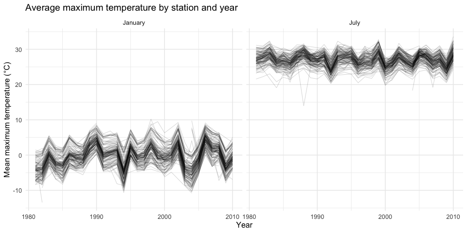
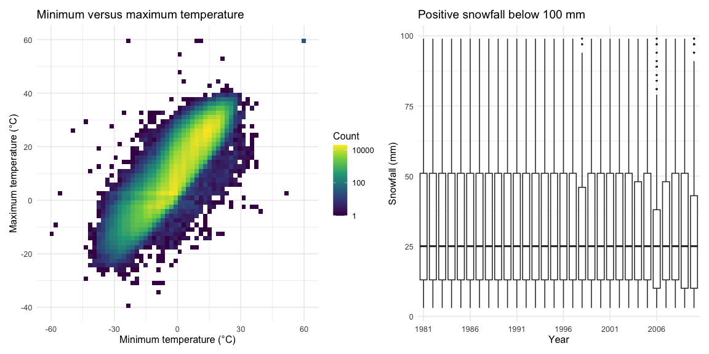
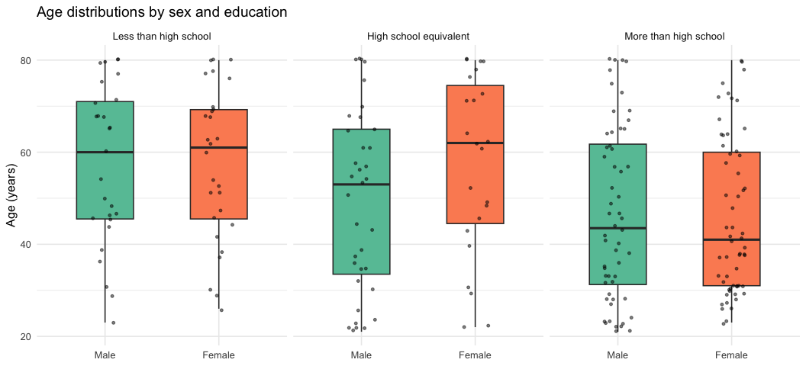
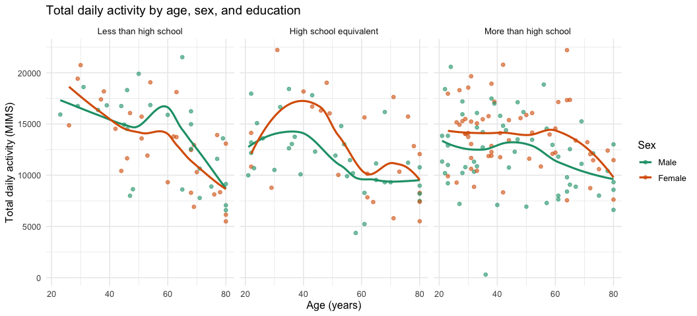
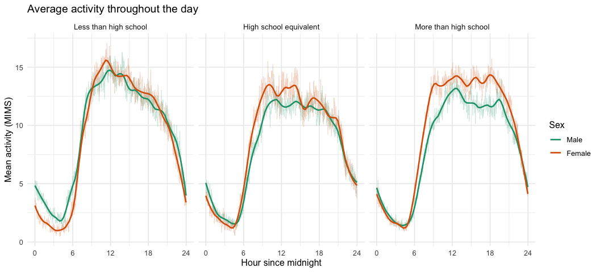

P8105 Homework 3
================
yl6378

# Problem 1

``` r
library(tidyverse)
library(patchwork)

data("ny_noaa", package = "p8105.datasets")

missing_table =
  ny_noaa |>
  summarize(across(everything(), ~ mean(is.na(.x)))) |>
  pivot_longer(
    everything(),
    names_to = "variable",
    values_to = "missing_fraction"
  )

missing_table |>
  mutate(
    missing_percentage =
      scales::percent(missing_fraction, accuracy = 0.1)
  ) |>
  select(variable, missing_percentage) |>
  knitr::kable(
    col.names = c("Variable", "Missing observations")
  )
```

| Variable | Missing observations |
|:---------|:---------------------|
| id       | 0.0%                 |
| date     | 0.0%                 |
| prcp     | 5.6%                 |
| snow     | 14.7%                |
| snwd     | 22.8%                |
| tmax     | 43.7%                |
| tmin     | 43.7%                |

The dataset contains 2,595,176 observations and 7 variables from 747
weather stations in New York State. Each row represents a station-date
observation between 1981 and 2010. Variables include station ID, date,
precipitation, snowfall, snow depth, and daily maximum and minimum
temperatures.

Missingness is most substantial for maximum and minimum temperature,
with 43.7% of observations missing for each variable. Snow depth has
22.8% missingness, followed by snowfall at 14.7% and precipitation at
5.6%. Station IDs and dates have no missing values. This limits
comparisons because summaries may be based on different subsets of
station-days.

``` r
noaa =
  ny_noaa |>
  mutate(
    year = lubridate::year(date),
    month = lubridate::month(date),
    day = lubridate::day(date),
    tmax = as.numeric(tmax) / 10,
    tmin = as.numeric(tmin) / 10,
    prcp = prcp / 10
  )

snow_counts =
  noaa |>
  filter(!is.na(snow)) |>
  count(snow, sort = TRUE)

snow_counts |>
  slice_head(n = 10) |>
  knitr::kable(
    col.names = c("Snowfall (mm)", "Number of observations"),
    caption = "Ten most commonly observed snowfall values"
  )
```

| Snowfall (mm) | Number of observations |
|--------------:|-----------------------:|
|             0 |                2008508 |
|            25 |                  31022 |
|            13 |                  23095 |
|            51 |                  18274 |
|            76 |                  10173 |
|             8 |                   9962 |
|             5 |                   9748 |
|            38 |                   9197 |
|             3 |                   8790 |
|           102 |                   6552 |

Ten most commonly observed snowfall values

Separate year, month, and day variables were created. Maximum and
minimum temperatures were converted to degrees Celsius, and
precipitation was converted to millimeters. Snowfall and snow depth were
already measured in millimeters.

The most common snowfall value is 0 mm, with 2,008,508 observations.
Zero snowfall is expected to be common because many station-days have no
snowfall. Common positive values may reflect rounding and conversion
from measurements originally recorded in inches.

``` r
station_temperature =
  noaa |>
  filter(month %in% c(1, 7)) |>
  group_by(id, year, month) |>
  summarize(
    observed_days = sum(!is.na(tmax)),
    mean_tmax = if (all(is.na(tmax))) {
      NA_real_
    } else {
      mean(tmax, na.rm = TRUE)
    },
    .groups = "drop"
  ) |>
  mutate(
    month = factor(
      month,
      levels = c(1, 7),
      labels = c("January", "July")
    )
  )

station_temperature |>
  ggplot(aes(x = year, y = mean_tmax, group = id)) +
  geom_line(alpha = 0.2, linewidth = 0.3, na.rm = TRUE) +
  facet_wrap(~ month) +
  labs(
    title = "Average maximum temperature by station and year",
    x = "Year",
    y = "Mean maximum temperature (°C)"
  ) +
  theme_minimal(base_size = 12)
```

<!-- -->

Each line represents a weather station. The panels allow comparison of
seasonal differences and year-to-year variation. Differences among
stations may reflect geography, while changes shared by many stations
may reflect regional weather patterns.

``` r
station_temperature |>
  filter(!is.na(mean_tmax)) |>
  group_by(month) |>
  slice_min(mean_tmax, n = 1, with_ties = FALSE) |>
  ungroup() |>
  select(month, id, year, mean_tmax, observed_days) |>
  knitr::kable(
    digits = 1,
    caption = "Lowest station-year mean temperature in each month"
  )
```

| month   | id          | year | mean_tmax | observed_days |
|:--------|:------------|-----:|----------:|--------------:|
| January | USC00301723 | 1982 |     -13.4 |            31 |
| July    | USC00308962 | 1988 |      14.0 |            31 |

Lowest station-year mean temperature in each month

The lowest January station-year mean maximum temperature was −13.4°C at
station USC00301723 in 1982. The lowest July value was 14.0°C at station
USC00308962 in 1988. Both averages use 31 observed days, so neither is
explained by having only a few daily observations. These values warrant
further inspection, but station location and measurement quality should
be checked before treating them as errors.

## Temperature relationship and snowfall distributions

``` r
temperature_plot =
  noaa |>
  filter(!is.na(tmin), !is.na(tmax)) |>
  ggplot(aes(x = tmin, y = tmax)) +
  geom_bin_2d(bins = 60) +
  scale_fill_viridis_c(trans = "log10") +
  labs(
    title = "Minimum versus maximum temperature",
    x = "Minimum temperature (°C)",
    y = "Maximum temperature (°C)",
    fill = "Count"
  ) +
  theme_minimal(base_size = 12)

snowfall_plot =
  noaa |>
  filter(snow > 0, snow < 100) |>
  ggplot(aes(x = factor(year), y = snow)) +
  geom_boxplot(outlier.size = 0.3) +
  scale_x_discrete(
    breaks = as.character(seq(1981, 2010, by = 5))
  ) +
  labs(
    title = "Positive snowfall below 100 mm",
    x = "Year",
    y = "Snowfall (mm)"
  ) +
  theme_minimal(base_size = 12)

temperature_plot + snowfall_plot
```

<!-- -->

The two-dimensional binned plot summarizes the relationship between
daily minimum and maximum temperatures. Color indicates the number of
observations within each bin, reducing the overplotting that would occur
in a scatterplot of the full dataset.

The snowfall boxplots compare the median, spread, and upper tails of
positive snowfall below 100 mm across years. Because zero snowfall and
events of 100 mm or more are excluded, this figure does not describe
annual snowfall totals or snowfall frequency.

# Problem 2

``` r
# Find the header below any introductory metadata.
covar_lines = read_lines("data/nhanes_covar.csv")

header_row = which(
  str_detect(covar_lines, regex("SEQN", ignore_case = TRUE))
)[1]

covar_raw =
  read_csv(
    "data/nhanes_covar.csv",
    skip = header_row - 1,
    na = c("", "NA", ".")
  ) |>
  rename_with(tolower)

covar =
  covar_raw |>
  drop_na() |>
  filter(age >= 21) |>
  mutate(
    sex = factor(
      sex,
      levels = c(1, 2),
      labels = c("Male", "Female")
    ),
    education = factor(
      education,
      levels = c(1, 2, 3),
      labels = c(
        "Less than high school",
        "High school equivalent",
        "More than high school"
      )
    )
  )

accel =
  read_csv("data/nhanes_accel.csv") |>
  rename_with(tolower)

nhanes =
  covar |>
  inner_join(accel, by = "seqn") |>
  pivot_longer(
    cols = matches("^min\\d+$"),
    names_to = "minute",
    names_prefix = "min",
    values_to = "mims"
  ) |>
  mutate(
    minute = as.integer(minute),
    hour = (minute - 1) / 60
  )

participants =
  nhanes |>
  distinct(seqn, .keep_all = TRUE) |>
  select(all_of(names(covar)))
```

Participants younger than 21 and those with missing demographic
information were excluded. Sex and education were encoded as factors,
with education ordered from less than high school to more than high
school. Activity measurements were reshaped into one row per participant
per minute, retaining the original demographic variables.

The merged dataset contains 228 participants and 328,320
participant-minute observations. MIMS measures activity intensity, and
the hour variable expresses time since midnight.

``` r
demographic_counts =
  participants |>
  count(education, sex) |>
  pivot_wider(
    names_from = sex,
    values_from = n,
    values_fill = 0
  )

demographic_counts |>
  knitr::kable(
    col.names = c("Education", "Male", "Female"),
    caption = "Participant counts by education and sex"
  )
```

| Education              | Male | Female |
|:-----------------------|-----:|-------:|
| Less than high school  |   27 |     28 |
| High school equivalent |   35 |     23 |
| More than high school  |   56 |     59 |

Participant counts by education and sex

``` r
participants |>
  ggplot(aes(x = sex, y = age, fill = sex)) +
  geom_boxplot(width = 0.5, outlier.shape = NA) +
  geom_jitter(width = 0.12, alpha = 0.5, size = 1) +
  facet_wrap(~ education) +
  scale_fill_brewer(palette = "Set2") +
  labs(
    title = "Age distributions by sex and education",
    x = NULL,
    y = "Age (years)"
  ) +
  theme_minimal(base_size = 12) +
  theme(
    legend.position = "none",
    strip.text = element_text(size = 10)
  )
```

<!-- -->

``` r
participants |>
  group_by(education, sex) |>
  summarize(
    participants = n(),
    median_age = median(age),
    .groups = "drop"
  ) |>
  knitr::kable(
    digits = 1,
    caption = "Participant counts and median ages"
  )
```

| education              | sex    | participants | median_age |
|:-----------------------|:-------|-------------:|-----------:|
| Less than high school  | Male   |           27 |       60.0 |
| Less than high school  | Female |           28 |       61.0 |
| High school equivalent | Male   |           35 |       53.0 |
| High school equivalent | Female |           23 |       62.0 |
| More than high school  | Male   |           56 |       43.5 |
| More than high school  | Female |           59 |       41.0 |

Participant counts and median ages

The more-than-high-school group is the largest, with 115 participants
(56 men and 59 women). The less-than-high-school group includes 27 men
and 28 women, while the high-school-equivalent group includes 35 men and
23 women.

Participants with more than a high school education are younger: median
ages are 43.5 years for men and 41 years for women, compared with 60 and
61 years in the less-than-high-school group. Within the
high-school-equivalent group, women have a higher median age than men
(62 versus 53 years). These age differences should be considered when
comparing activity across groups.

``` r
daily_activity =
  nhanes |>
  group_by(seqn, sex, age, education) |>
  summarize(
    observed_minutes = sum(!is.na(mims)),
    total_activity = if (all(is.na(mims))) {
      NA_real_
    } else {
      sum(mims, na.rm = TRUE)
    },
    .groups = "drop"
  )

daily_activity |>
  summarize(
    minimum_observed_minutes = min(observed_minutes),
    maximum_observed_minutes = max(observed_minutes)
  ) |>
  knitr::kable(
    caption = "Activity measurement coverage per participant"
  )
```

| minimum_observed_minutes | maximum_observed_minutes |
|-------------------------:|-------------------------:|
|                     1440 |                     1440 |

Activity measurement coverage per participant

``` r
daily_activity |>
  ggplot(aes(x = age, y = total_activity, color = sex)) +
  geom_point(alpha = 0.6) +
  geom_smooth(method = "loess", se = FALSE) +
  facet_wrap(~ education) +
  scale_color_brewer(palette = "Dark2") +
  labs(
    title = "Total daily activity by age, sex, and education",
    x = "Age (years)",
    y = "Total daily activity (MIMS)",
    color = "Sex"
  ) +
  theme_minimal(base_size = 12) +
  theme(strip.text = element_text(size = 10))
```

<!-- -->

``` r
daily_activity |>
  group_by(education, sex) |>
  summarize(
    median_total_activity = median(total_activity, na.rm = TRUE),
    .groups = "drop"
  ) |>
  knitr::kable(
    digits = 1,
    caption = "Median total daily activity by group"
  )
```

| education              | sex    | median_total_activity |
|:-----------------------|:-------|----------------------:|
| Less than high school  | Male   |               14935.1 |
| Less than high school  | Female |               13336.2 |
| High school equivalent | Male   |               11220.8 |
| High school equivalent | Female |               12062.8 |
| More than high school  | Male   |               11977.5 |
| More than high school  | Female |               13977.4 |

Median total daily activity by group

All 228 participants have 1,440 observed minutes, so daily activity
totals are based on complete 24-hour coverage.

In the less-than-high-school group, men have a higher median total
activity than women (14,935.1 versus 13,336.2 MIMS). Women have higher
medians in the high-school-equivalent group (12,062.8 versus 11,220.8)
and the more-than-high-school group (13,977.4 versus 11,977.5). Thus,
the direction of the sex difference varies across education groups.
These unadjusted summaries do not account for differences in age
composition and do not establish causal effects.

``` r
minute_activity =
  nhanes |>
  group_by(education, sex, minute, hour) |>
  summarize(
    mean_mims = if (all(is.na(mims))) {
      NA_real_
    } else {
      mean(mims, na.rm = TRUE)
    },
    .groups = "drop"
  )

minute_activity |>
  ggplot(aes(x = hour, y = mean_mims, color = sex)) +
  geom_line(alpha = 0.25, linewidth = 0.3) +
  geom_smooth(
    method = "loess",
    span = 0.15,
    se = FALSE,
    linewidth = 0.9
  ) +
  facet_wrap(~ education) +
  scale_x_continuous(
    breaks = seq(0, 24, by = 6),
    limits = c(0, 24)
  ) +
  scale_color_brewer(palette = "Dark2") +
  labs(
    title = "Average activity throughout the day",
    x = "Hour since midnight",
    y = "Mean activity (MIMS)",
    color = "Sex"
  ) +
  theme_minimal(base_size = 12) +
  theme(strip.text = element_text(size = 10))
```

<!-- -->

The three panels compare activity timing and intensity across education
categories, with color identifying sex. Faint lines show minute-specific
group means, while smooth curves emphasize broader daily patterns. These
curves describe group averages rather than individual participants’
activity trajectories.

# Problem 3
